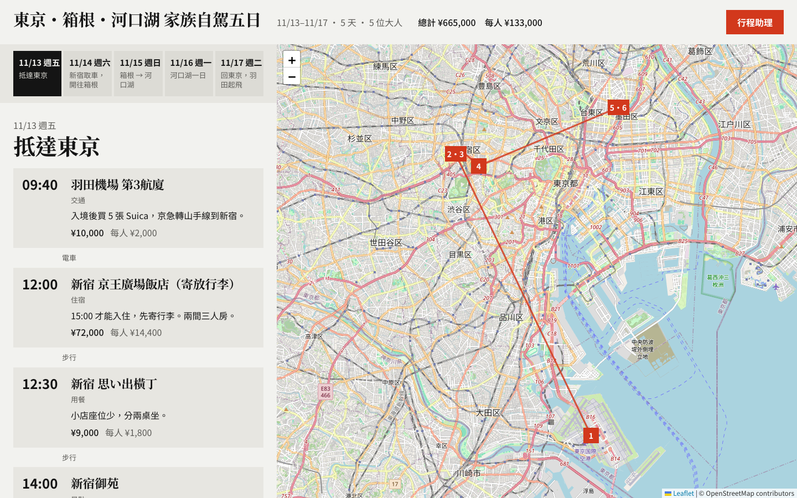
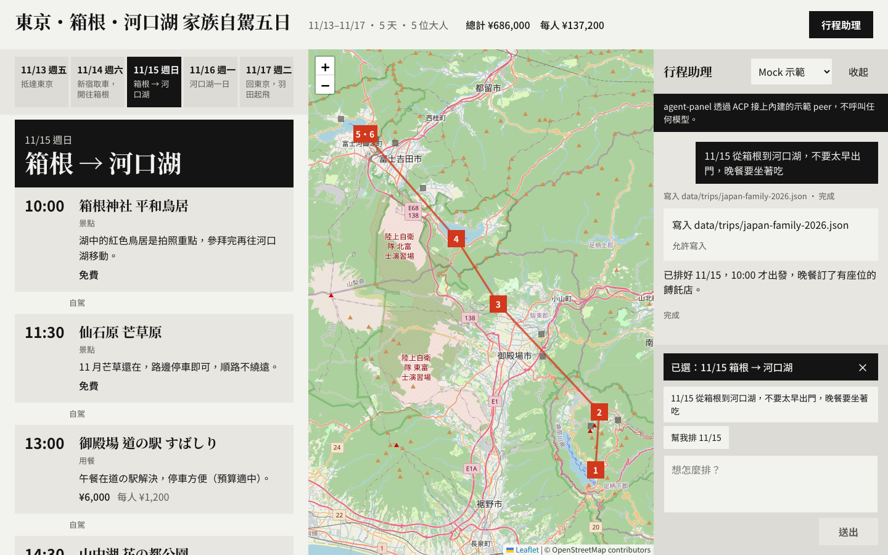
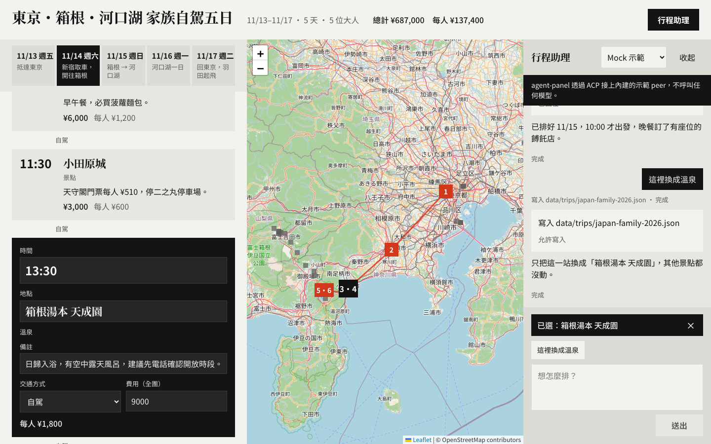
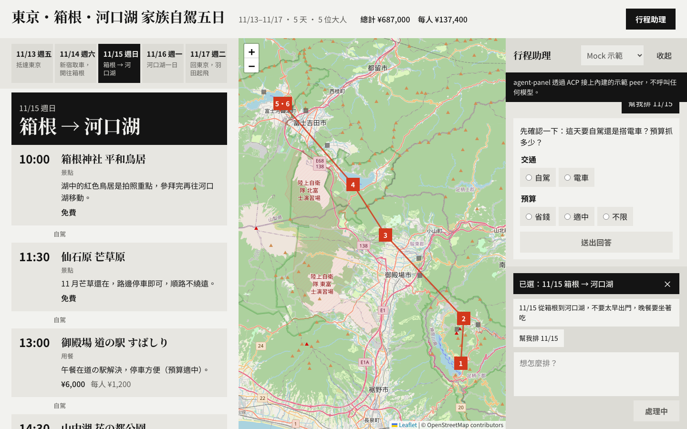
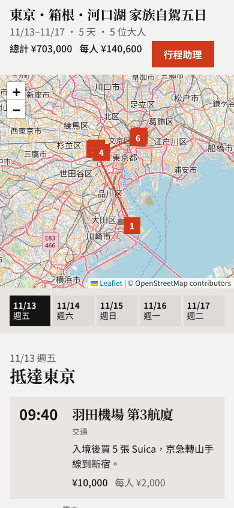
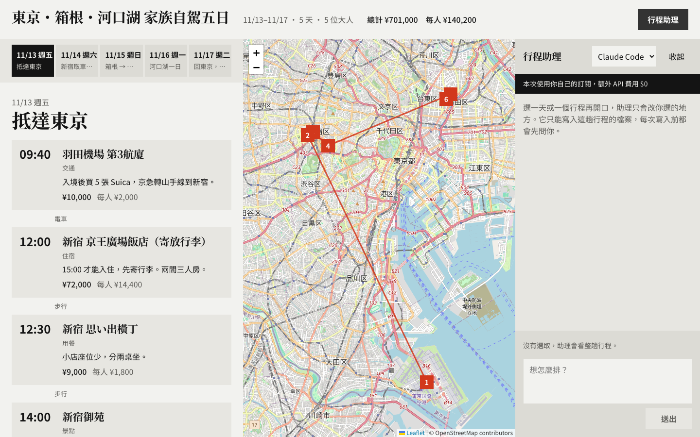
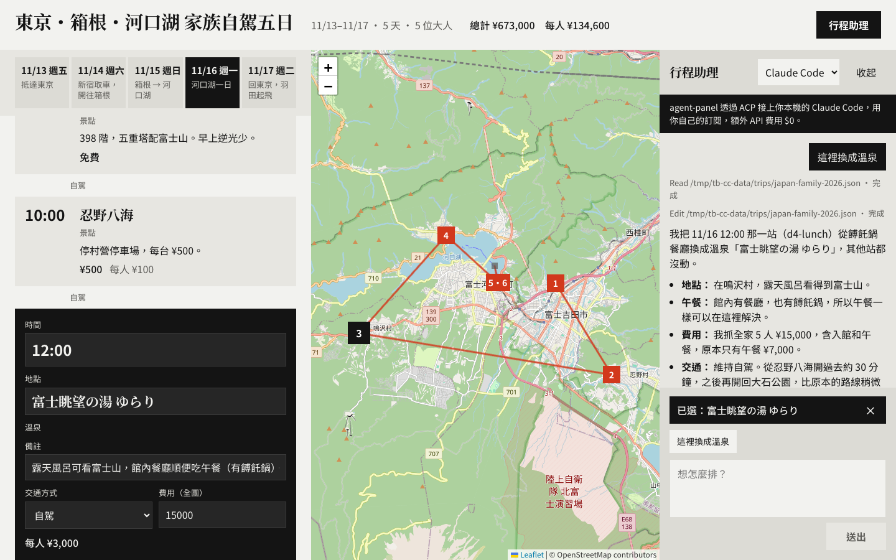

# 旅遊行程板

把一趟旅行排成一天一條時間軸，旁邊是地圖。每張行程卡有時間、地點、備註、交通方式和費用，可以直接改，也可以拖到別的時間或別的日子。行程存在 `data/trips/*.json`。

右上角的「行程助理」會打開代理面板。面板用 [agent-panel](https://github.com/Jacky97s/agent-panel) 接上你本機的 Claude Code 或 Codex，花的是你自己的訂閱。沒有安裝任何代理時，內建的示範 peer 一樣能排行程。



內建範例是「東京・箱根・河口湖 家族自駕五日」：2026/11/13 到 11/17，五位大人。11/15 箱根到河口湖那天只放了晚上的旅館，留給代理來排。

## 怎麼操作

1. 點上方的日期切換天數。地圖會框住那天的行程，紅色數字是順序。
2. 點一張卡片選取它，選取後可以直接改時間、地點、備註、交通方式和費用。按 Esc 取消選取。
3. 拖曳卡片調整順序，拖到上方的日期就搬到那天。鍵盤用 Alt + ↑ / ↓。
4. 按「行程助理」打開面板。面板預設是關著的，載入頁面時不會自己打開。
5. 選 11/15，送出「11/15 從箱根到河口湖，不要太早出門，晚餐要坐著吃」。允許寫入後，那天的卡片和地圖標記會直接更新，不必重新整理。



6. 選一張卡片，送出「這裡換成溫泉」。代理只改這一張，其他卡片不動。



7. 送出「幫我排 11/15」。需求不夠清楚，代理會先跳出提問卡，問要自駕還是搭電車、預算抓多少。



手機寬度下，地圖在上，時間軸在下，面板改成全螢幕。



## agent-panel 在這裡做了什麼

| 機制 | 這個 app 怎麼用 |
| --- | --- |
| Capability | `trip`，定義在 `server/capability.ts`：系統提示、`buildContext`、可寫入目錄、允許的工具 |
| 選取即上下文 | 選到的那天或那張卡片，以 `day`、`stopId`、`selection` 送進 prompt。面板上的「已選：…」就是這次會送出的內容 |
| 可寫入目錄 | 只有 `data/trips/`。agent 透過 ACP 的 `fs/read_text_file`、`fs/write_text_file` 碰到它以外的路徑時，框架會擋下 |
| 允許的工具 | 只有讀寫類工具名稱（`read`、`write`、`edit` 等），沒有 shell |
| 提問卡 | 交通方式與預算。代理用 ACP form elicitation 發問 |
| 寫入許可卡 | 示範 peer 每次寫檔前都會發 `session/request_permission` |
| 即時更新 | 伺服器監看 `data/trips/`，用 Server-Sent Events（`/api/events`）通知頁面重讀。不管是 app、示範 peer，還是 Claude Code 自己的工具寫的，都會即時反映 |
| 自己的訂閱 | `ACP_PRESETS['claude-code']` 與 `ACP_PRESETS.codex` |

切到 Claude Code 或 Codex 時，面板上方會顯示「本次使用你自己的訂閱，額外 API 費用 $0」。



下圖是實際接上 Claude Code，選取一張午餐卡片後說「這裡換成溫泉」。Claude Code 讀了行程檔，只改了那一站，頁面隨即更新。



### 座標從哪裡來

代理新增地點時要自己附上經緯度。少了座標的地點，伺服器會用免費的 [Nominatim](https://nominatim.org/)（OpenStreetMap）查，每秒最多一次。查到或查不到都記在 `data/cache/geocode.json`，同一個地名不會再查第二次。設定 `TRIP_GEOCODE=off` 就完全不連網。查不到的卡片會標示「找不到座標」。

地圖圖磚來自 OpenStreetMap，不需要任何 API key。

### 框架怎麼引入

agent-panel 還沒發到 npm。這個 repo 把它放在 git submodule `vendor/agent-panel`，釘在 commit `c47a6717a68e731e0ac5db653679650249aad6d7`。那是 `cursor/agent-panel-v1-fef3` 分支的最後一個 commit，已經併進 agent-panel 的 main，遠端分支已刪除。`pnpm-workspace.yaml` 把 `vendor/agent-panel/packages/*` 列為 workspace 套件，`@agent-panel/core`、`@agent-panel/server`、`@agent-panel/react` 以 `workspace:*` 連結。框架原始碼沒有複製進這個 repo。

`pnpm dev`、`pnpm test`、`pnpm test:e2e` 執行前都會先編譯這三個套件（`pnpm prepare:agent`）。

## 執行

需要 Node 22.18 以上（示範 peer 是直接用 Node 執行的 `.ts` 檔）與 pnpm。

```bash
git clone --recurse-submodules https://github.com/Jacky97s/agent-panel-trip-board.git
cd agent-panel-trip-board
pnpm install
pnpm dev
```

clone 時沒有帶 submodule 的話，先執行：

```bash
git submodule update --init
```

然後在瀏覽器打開 http://127.0.0.1:5173 。

### Mock 示範

預設就是這個模式。示範 peer（`server/mock-trip-agent.ts`）是不呼叫模型的 ACP agent，規則寫死在 `shared/intent.ts` 和 `shared/plans.ts`。它會讀行程檔、發提問卡和寫入許可卡，再寫出合法的 JSON。它只有 11/15 箱根到河口湖的範本，其他日期會直接告訴你。測試都走這條路。

### Claude Code

在面板的「代理」選單選 Claude Code。開發伺服器會重啟，改用這個指令接上 ACP：

```bash
npx -y @agentclientprotocol/claude-agent-acp
```

本機要先登入過 Claude Code。

### Codex

在選單選 Codex，對應的指令是：

```bash
npx -y @agentclientprotocol/codex-acp
```

本機要先登入過 Codex。

選單的選擇存在 `data/runtime-agent.json`，不進版控。刪掉這個檔案就回到 Mock。

### 環境變數

| 變數 | 用途 |
| --- | --- |
| `TRIP_DATA` | 資料目錄，預設 `./data`。代理只能寫它底下的 `trips/` |
| `TRIP_GEOCODE` | 設成 `off` 就不連 Nominatim |

## 測試

```bash
pnpm test
pnpm test:e2e
```

`pnpm test` 是 Vitest 單元測試。除了行程資料、意圖判斷、排程範本之外，還會在同一個 process 裡啟動真正的 `createAgentServer`，讓示範 peer 跑完整的 ACP 回合：允許與拒絕寫入、提問卡、只換選取的那一站，以及寫到 `data/trips/` 外面時被擋下。

`pnpm test:e2e` 用 Playwright 和示範 peer 開啟頁面，把資料複製到 `e2e/.data`，不會動到 `data/`。它檢查五件事：載入時面板關著、選日期後排出 11/15、只換選取的卡片、提問卡、鍵盤排序與跨日拖曳。

## 框架目前的限制

這些是 agent-panel 目前沒有、這個 app 在外面補上的地方：

- 一個開發伺服器只綁一個 ACP 行程，沒有執行中換代理的 API。切換代理會重啟 Vite。
- 內建的 `AgentPanel` 和 `AgentDock` 寫死英文字串，也沒有放代理選單或訂閱提示的位置。這裡用 `useAgentState()` 和 `useCapability()` 自己做了中文面板。
- `respond` 和 `setDockOpen` 沒有從 `@agent-panel/react` 匯出。回答提問卡和許可卡時，面板直接呼叫文件寫明的 `POST /__agent/sessions/:id/respond`。
- 代理訊息沒有 `messageId` 時，框架用更新類型當 id，同一個 session 的後續回覆會接在第一則後面。示範 peer 每則訊息都帶唯一的 id。
- context 只保留第一層的字串、數字與布林，物件會被丟掉。選取的卡片先轉成 JSON 字串再送。
- 框架沒有「檔案已變更」事件，所以 app 自己監看 `data/trips/` 並用 SSE 通知頁面。
- `allowedTools` 比對的是 permission request 的工具名稱，但 ACP 的 tool call 不一定帶名稱，沒有名稱時一律會問使用者。實際接 Claude Code 時，它沒有發出寫入許可請求，直接寫了檔案。
- 可寫入目錄只在 agent 走 ACP 的 `fs/read_text_file` 和 `fs/write_text_file` 時才檢查。agent 如果用自己的檔案工具直接寫磁碟，框架擋不住，只剩系統提示在約束它。Claude Code 那次寫入走的是哪條路，目前還沒驗證。
- 被可寫入目錄擋下的寫入，在 agent 端只看到 `Internal error`，看不出原因。

## 授權

MIT，見 [LICENSE](LICENSE)。
